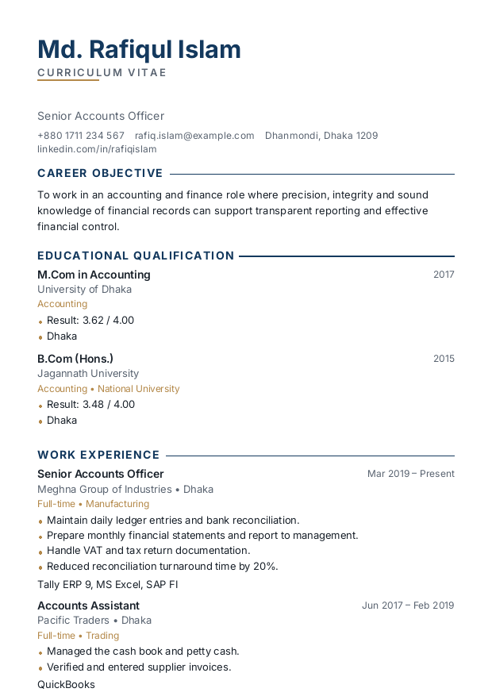

# SHOHAN CV STUDIO

**A fully offline, Bangla-first CV / résumé studio for Windows.** Build professional
Bangladeshi-format CVs, design them in a live studio, and export editable DOCX,
searchable PDF or send them straight to an A4 printer — with no account, no
internet connection, no subscription and no telemetry.

<p align="center">
  
  
</p>

---

## What it does

| Area | Detail |
| --- | --- |
| **20 CV templates** | Each one a different composition — header, body grid, heading treatment, entry rhythm and typography — not the same page recoloured. A4 210 × 297 mm exactly. |
| **19-step wizard** | Guided data entry for personal details, education, experience, skills, languages, training, projects and optional sections. |
| **Dynamic sections** | Optional sections are switchable, reorderable and support custom titles. A section that is empty or turned off **never** produces a heading, a rule or a blank page in any output format. |
| **Live studio** | Edit any field and see the A4 page update immediately. Undo/redo, zoom, page guides, template switching without touching your text. |
| **Exports** | Editable `.docx` (real A4, selectable text, Bengali Unicode, footer page numbers), searchable `.pdf` (Chromium's own print-to-PDF), and direct printing with a preview. |
| **Customers & projects** | Save multiple projects per person, duplicate, soft-delete and restore. Search, filter and sort across everything. |
| **Backup** | One-click ZIP backup (database + manifest + SHA-256 verification), restore with an automatic safety copy of the current data first. |
| **Offline only** | SQLite (sql.js) on disk, embedded fonts, no network code paths, no analytics, no activation. |

## Design system

The application UI and every CV template follow the same two rules:

- **Golden Ratio (φ = 1.618…) for composition** — major/minor splits, the type
  scale, card proportions.
- **The Golden Rules for usability** — hierarchy, contrast, alignment, 8-point
  spacing rhythm, and never decoration at the expense of legibility.

Themes: light, dark, or follow Windows. The layout is verified from 1024 × 768
through 1920 × 1080.

## Windows support

The desktop build uses **Electron 22.3.27 (Chromium 108, Node 16.17)**, the last
Electron line that runs on Windows 7. Both `ia32` (32-bit) and `x64` installers are
produced, plus a portable executable that needs no installation.

> **Honesty note:** the compatibility matrix in
> [`docs/COMPATIBILITY.md`](docs/COMPATIBILITY.md) marks every operating system as
> **Not tested** unless it was actually run during this build. Nothing in this
> repository claims a platform pass that was not observed.

## Getting started

```bash
npm install          # Node 18+ (dev only; the app itself ships Node 16 via Electron)
npm run dev          # http://localhost:5173 — browser preview
npm run desktop:dev  # Electron window with the real preload bridge
npm run build        # typecheck → production bundle → CSP injection
npm run dist:win     # Windows installers into release/
```

Full instructions: [`docs/INSTALLATION.md`](docs/INSTALLATION.md).

## Documentation

| Document | Contents |
| --- | --- |
| [Installation Guide](docs/INSTALLATION.md) | Requirements, install, portable use, uninstall, data locations |
| [User Manual](docs/USER_MANUAL.md) | Every screen, the 19-step wizard, templates, exporting, backups |
| [Technical Documentation](docs/TECHNICAL.md) | Architecture, data model, render pipeline, security model |
| [Compatibility Matrix](docs/COMPATIBILITY.md) | Per-OS status, honestly marked |
| [Testing Report](docs/TESTING.md) | What was executed, what passed, what could not be run |
| [Known Issues](docs/KNOWN_ISSUES.md) | Current limitations and workarounds |
| [Release Notes](docs/RELEASE_NOTES.md) | What is in 1.0.0 |

## Repository layout

```
electron/            Electron main process + preload bridge (contextIsolation on)
src/database/        SQLite schema, engine, repository (25 tables)
src/document/        HTML/print renderer, CSS builder, DOCX exporter
src/templates/       20-template catalogue, palettes, font pairs
src/features/        Screens: dashboard, wizard, gallery, editor, projects,
                     customers, exports, backup, settings, help
src/lib/             Golden-ratio maths, section engine, colour maths, defaults
scripts/             CSP injection, font builder, documentation preview renderer
tests/               Vitest suites (engine, DOCX, database, design, sections, UI)
docs/                Deliverable documentation + generated template previews
```

## Licence and fonts

Application code © 2026 SHOHAN CV STUDIO. Bundled typefaces — Inter, Lora, Noto
Sans Bengali and Noto Serif Bengali — are used under the SIL Open Font License
1.1; the licence texts ship in [`src/assets/fonts/`](src/assets) and are credited
in Settings → About.
